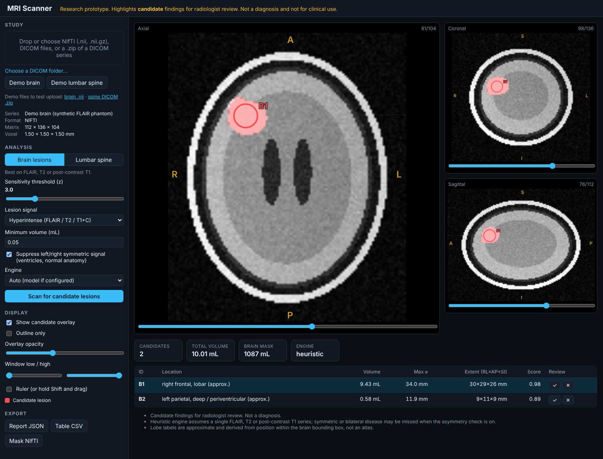
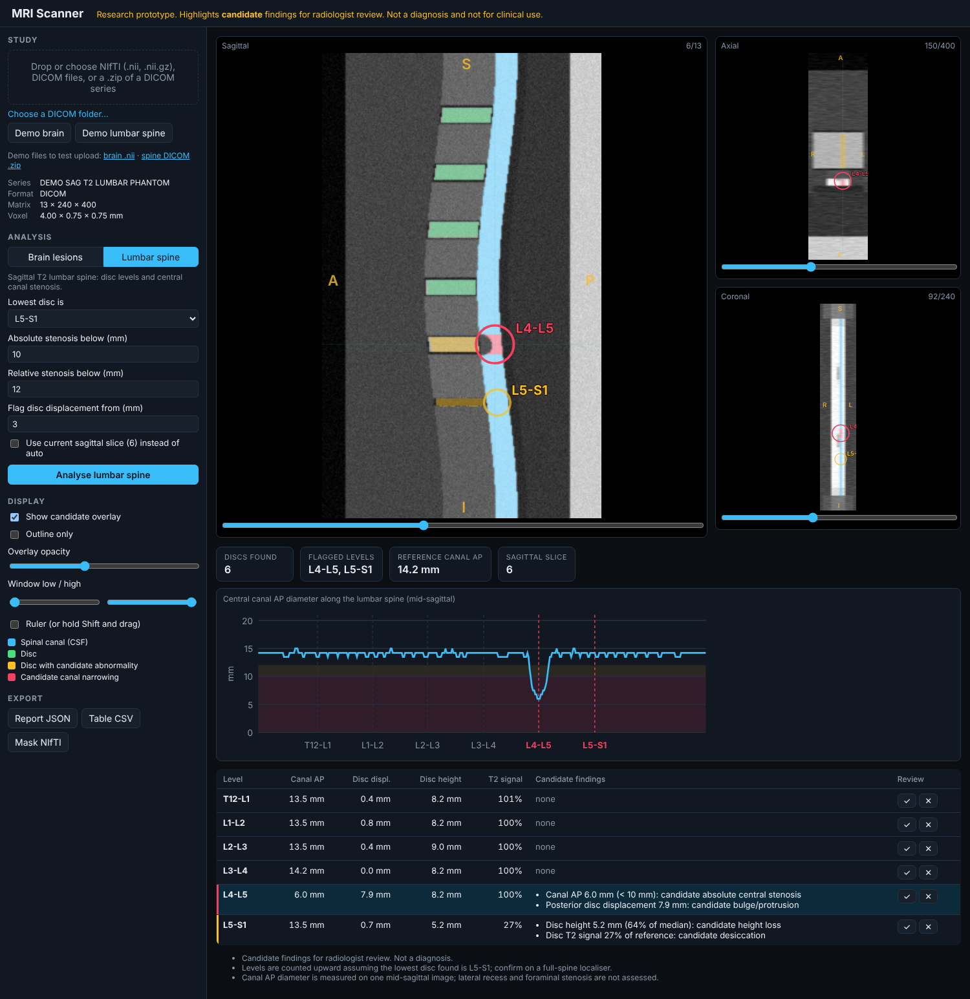

# MRI Scanner

A web app for reviewing brain and lumbar spine MRI. Load a study in DICOM or
NIfTI, run an analysis, and the app highlights **candidate** regions with
measurements (location, volume, diameters, canal size) for a radiologist to
accept or reject.

> **Research prototype.** Outputs are candidate findings to direct review.
> They are not diagnoses and the app is not validated for clinical use.

| Brain: candidate lesions | Lumbar spine: discs and canal stenosis |
| --- | --- |
|  |  |

## What it does

**Input**
- NIfTI (`.nii`, `.nii.gz`), DICOM files, a DICOM folder, or a `.zip` of a series.
- Every study is reoriented to RAS+ so DICOM and NIfTI behave identically. If an
  upload contains several DICOM series, the largest is used.
- Studies stay in memory on the server (last 6) and are never written to disk.
  Patient identifiers are not copied into the app's metadata.

**Viewer**
- Linked axial, coronal and sagittal views with crosshair, scroll-wheel slicing,
  window/level, overlay opacity or outline mode, and a ruler in mm (Shift+drag).
- Findings table: click a row to jump to it; mark each candidate ✓ or ✕.
- Export a JSON report or CSV table (with review status) and the candidate mask as NIfTI.

**Brain: candidate lesions** (FLAIR, T2 or post-contrast T1)
- Estimates a brain mask, finds voxels whose signal is an outlier for the brain
  (robust z-score, adjustable sensitivity), and suppresses signal that is
  mirrored on the other hemisphere so ventricles and normal anatomy are not flagged.
- Per candidate: volume (mL), max diameter, RL×AP×SI extent, centroid in scanner
  mm, side and approximate lobe/depth, and a score.
- A trained model can replace the heuristic engine (see below).

**Spine: one focused use case**, lumbar disc abnormalities and central canal
stenosis on sagittal T2. This was chosen over "read the whole spine" because it
is the most common lumbar MRI question and the key measurements come from a
single mid-sagittal image:
- Traces the CSF-filled canal and plots its AP diameter along the spine.
- Finds discs, labels levels upward from the lowest disc (L5-S1 by default,
  configurable for transitional anatomy).
- Per level: canal AP diameter, posterior disc displacement into the canal,
  disc height and T2 signal. Flags candidate absolute (< 10 mm) or relative
  (< 12 mm) central stenosis, bulge/protrusion, height loss and desiccation.
  Thresholds are adjustable.
- Not assessed: lateral recess and foraminal stenosis, cord signal, fractures,
  cervical/thoracic spine.

## Running it

Requires Python 3.10+ and Node 18+.

```bash
# backend
cd backend
python -m venv .venv && source .venv/bin/activate
pip install -r requirements-dev.txt
uvicorn app.main:app --reload --port 8000

# frontend (second terminal)
cd frontend
npm install
npm run dev        # http://localhost:5173, proxies /api to :8000
```

For a single process, run `npm run build` in `frontend/` and then start only
the backend; it serves the built app at http://localhost:8000.

Click **Demo brain** or **Demo lumbar spine** to try it with synthetic
phantoms, or download the demo files from the sidebar to exercise the upload
path (the spine demo is a real sagittal DICOM series in a zip).

Tests: `cd backend && pytest`. They check lesion detection and volume against
the phantom's ground truth, stenosis and desiccation at the right levels, that
DICOM and NIfTI produce the same geometry, and the API end to end.

## Using a pretrained model

No model weights ship with the repo. The common open brain-tumour models
(BraTS-trained MONAI bundles, nnU-Net) need four co-registered sequences and
carry research-only licences, so they cannot be bundled or run on a single
uploaded series as-is. To use a model you are licensed for, export it to ONNX
and set:

```bash
export MRI_BRAIN_ONNX=/path/to/model.onnx
```

Contract: input `(1, 1, X, Y, Z)` float32 in RAS+ orientation, z-scored;
output `(1, C, X, Y, Z)` where argmax > 0 is lesion. Fixed-size models are
resampled automatically. With the engine set to **Auto**, the model is used
when configured and the heuristic otherwise; the engine used is shown with the results.

## Layout

```
backend/app/
  loaders.py   DICOM / NIfTI / zip loading, RAS+ reorientation
  brain.py     brain mask, candidate lesion detection, measurements
  spine.py     canal tracing, disc detection, per-level measurements
  models.py    optional ONNX model hook
  demo.py      synthetic brain and lumbar spine phantoms
  main.py      FastAPI endpoints
frontend/src/
  App.tsx      layout, controls, export
  PlaneView.tsx, slicing.ts   canvas viewer, overlays, ruler
  Findings.tsx tables and canal diameter chart
```
