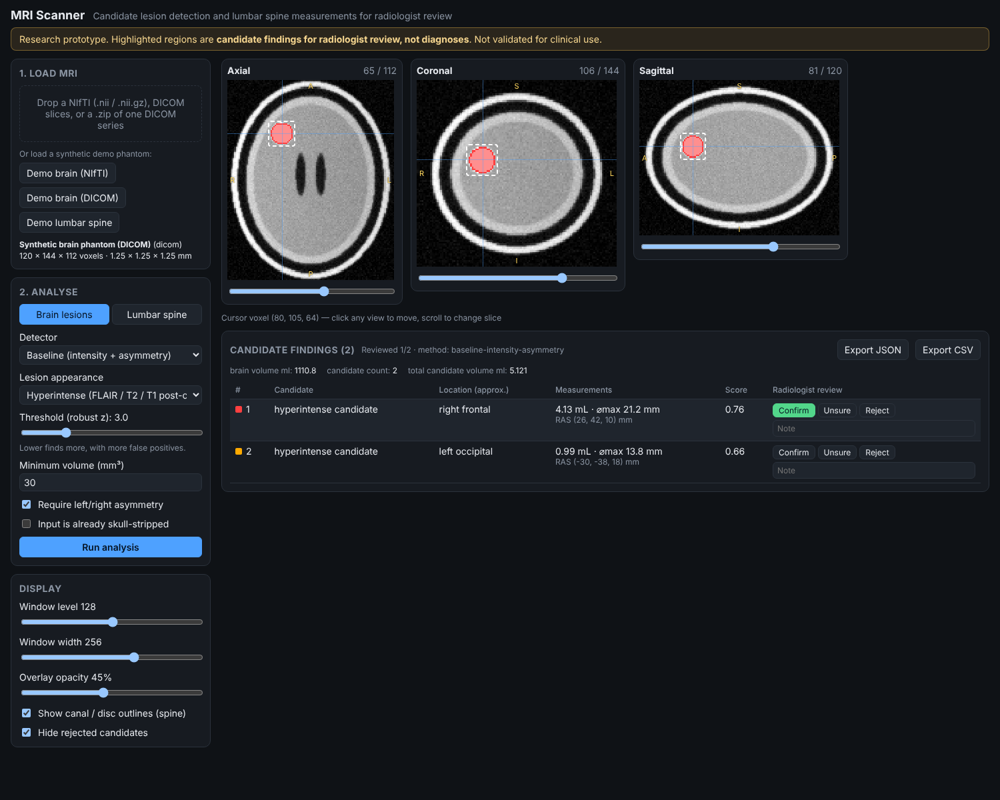
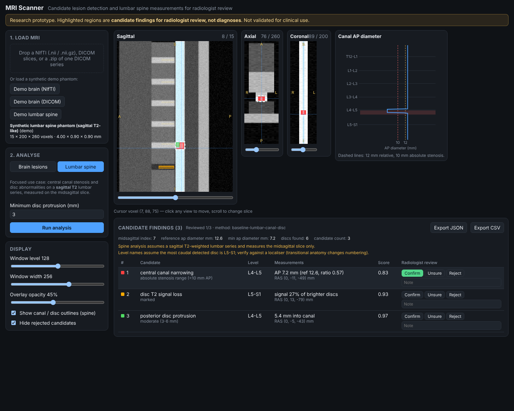

# MRI Scanner

A web app for reviewing brain and lumbar spine MRI. It loads DICOM or NIfTI, flags candidate
abnormal regions, measures them, and lets a reviewer confirm, reject or annotate each one before
exporting a report.

> **Research prototype.** Every output is a *candidate finding for radiologist review*, not a
> diagnosis. Nothing here is validated for clinical use.

## What it does

**Input**: a NIfTI file (`.nii`, `.nii.gz`), a set of DICOM slices, or a `.zip` of one DICOM series.
Volumes are reoriented to canonical RAS+ on load so measurements and left/right labels are consistent.

**Brain (lesions / tumours)**
- Extracts a brain mask, then flags regions that are intensity outliers relative to normal tissue
  and brighter than the mirrored point in the other hemisphere (FLAIR / T2 / post-contrast T1).
  A hypointense mode handles T1 "black hole" style lesions.
- Per candidate: volume (mm³ and mL), centroid in voxel and scanner (RAS mm) coordinates, bounding
  box, extent, maximum (Feret) diameter, equivalent sphere diameter, hemisphere and an approximate
  region (frontal, parietal, ...; geometric estimate, not atlas registration), and a heuristic score.
- Optional pretrained segmentation model via ONNX (see below) replaces the candidate mask; the
  measurements and viewer stay the same.

**Lumbar spine (focused use case: central canal stenosis and disc abnormalities on sagittal T2)**
- Why this one: on sagittal T2 the CSF in the thecal sac is the brightest structure, so the canal can
  be outlined reliably without a trained model, and the anteroposterior (AP) canal diameter is a
  standard, measurable stenosis criterion (about 12 mm relative, 10 mm absolute). Disc protrusion and
  disc signal loss are measured on the same slice. Foraminal stenosis, facets, fractures, cord signal
  and tumours are out of scope and not assessed.
- Picks the midsagittal slice, segments the canal, plots AP diameter along the spine, locates discs,
  and reports: **central canal narrowing** (min AP, reference AP, ratio, length, severity range),
  **posterior disc protrusion** (depth into canal), and **disc T2 signal loss** (possible desiccation).
- Levels are named assuming the lowest detected disc is L5-S1; the app flags this for verification.

**Viewer and review**
- Axial, coronal and sagittal views (radiological convention) with window/level, overlay opacity,
  crosshair navigation, slice scrolling and a dashed box around the selected candidate.
- Findings table: click to jump to a candidate; mark Confirm / Unsure / Reject; add notes; rejected
  candidates can be hidden. Export the reviewed findings as JSON or CSV.
- Built-in synthetic phantoms (brain via NIfTI or DICOM, lumbar spine) with known ground truth, so
  the whole flow runs without patient data.

## Screenshots




## Quick start

Requires Python 3.10+ and Node 18+.

```bash
# backend
cd backend
python3 -m pip install -r requirements-dev.txt
python3 -m uvicorn app.main:app --port 8000

# frontend (dev server with hot reload, proxies /api to :8000)
cd frontend
npm install
npm run dev        # open http://localhost:5173
```

Or build the frontend once (`npm run build`) and open http://localhost:8000; the backend serves
`frontend/dist` when it exists.

Run the tests with `cd backend && python3 -m pytest`.

## Using a pretrained model

The baseline detectors need no weights. To plug in a trained single-sequence 3D segmentation model
(for example a FLAIR lesion U-Net exported from MONAI or nnU-Net), export it to ONNX and describe it
in a JSON file:

```json
{
  "name": "flair-lesion-unet",
  "model_path": "flair_unet.onnx",
  "patch_size": [96, 96, 96],
  "normalization": "zscore_nonzero",
  "output": "softmax",
  "labels": {"1": "lesion"}
}
```

```bash
python3 -m pip install -r requirements-onnx.txt
MRI_BRAIN_MODEL=/path/to/model.json python3 -m uvicorn app.main:app --port 8000
```

The model receives `[1, 1, X, Y, Z]` float32 in canonical RAS+ voxel order at native resolution and
must return `[1, C, X, Y, Z]` scores. Models that need several co-registered sequences (such as
BraTS models using T1, T1c, T2 and FLAIR) or fixed 1 mm resampling need a matching export or extra
preprocessing; that is not built in yet. The adapter is tested with a stand-in model, not with
published weights.

## Accuracy, as far as it is known

On the bundled phantoms (see `backend/tests`): brain lesion volumes within about 6% of ground truth,
both lesions found on the correct side; spine narrowing found at L4-L5 (7.2 mm measured vs 7 mm),
the L4-L5 protrusion and the dark L5-S1 disc found. The canal segmentation reads about 1.5 mm
narrow on the phantom. **None of this has been evaluated on real patient scans.** The classical
detectors will produce false positives on real data (vessels, artefacts, normal bright structures)
and are meant to be tuned with the threshold controls, or replaced by a trained model.

## Layout

```
backend/app/
  loaders.py     NIfTI / DICOM / zip loading, DICOM geometry -> RAS affine
  volume.py      Volume container, canonical orientation, display scaling
  brain.py       brain mask + candidate lesion detection
  spine.py       lumbar canal / disc analysis
  measure.py     volume, diameter, location measurements
  onnx_model.py  optional pretrained model adapter
  phantoms.py    synthetic demo volumes with ground truth
  main.py        FastAPI endpoints
frontend/src/    React + TypeScript viewer
```

### API

| Method | Path | Purpose |
| --- | --- | --- |
| GET | `/api/health` | status and configured pretrained model |
| POST | `/api/studies` | upload (`files` multipart) |
| POST | `/api/demo/{brain,brain-dicom,spine}` | load a phantom |
| GET | `/api/studies/{id}/volume` | display voxels, uint8, C order (X, Y, Z) |
| POST | `/api/studies/{id}/analyze` | run analysis (`{"mode": "brain" \| "spine", ...}`) |
| GET | `/api/studies/{id}/labels` | label map of the last analysis, uint8 |

Studies are held in memory (last 8) and nothing is written to disk.
