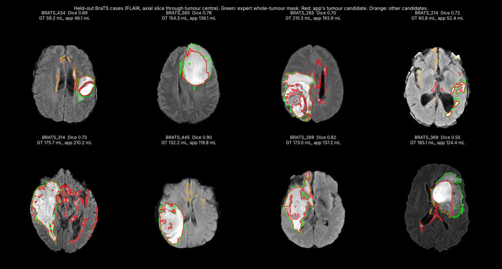
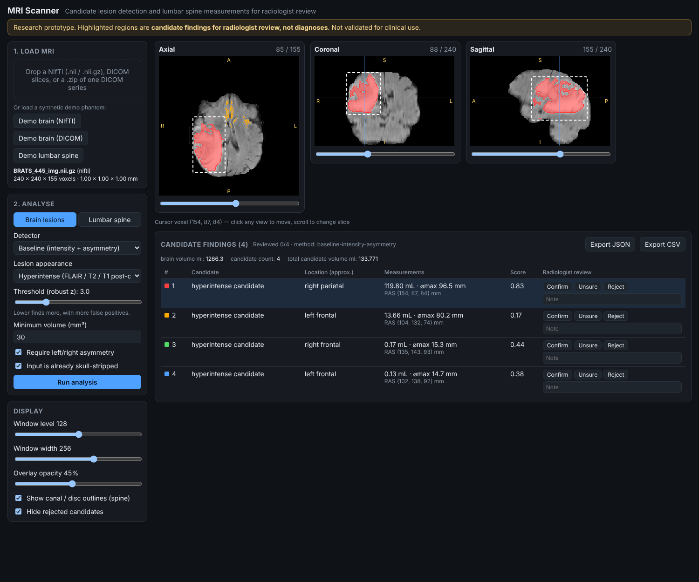
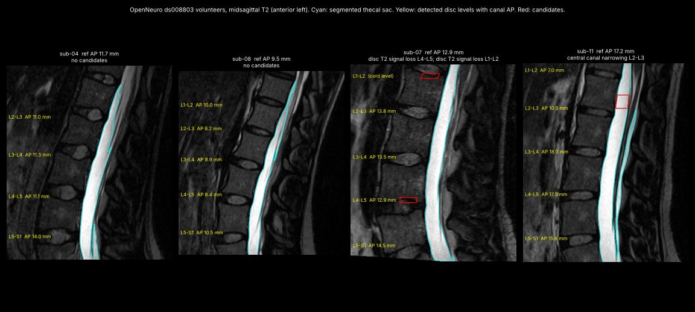
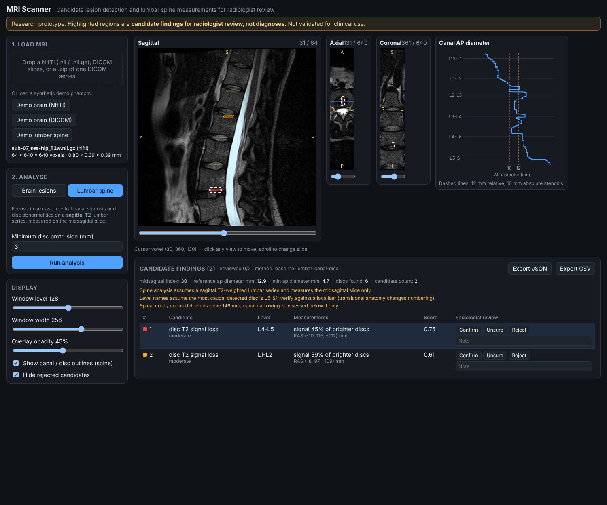

# Validation on real MRI data

Run with `python backend/scripts/validate_real_data.py brain|spine <ids...>`. The script
downloads the cases it needs into `.data-cache/` (git-ignored). No imaging data is committed.

## Data sources

| Use | Dataset | Licence | What it has |
| --- | --- | --- | --- |
| Brain | [Medical Segmentation Decathlon](http://medicaldecathlon.com/) Task01_BrainTumour (BraTS 2016/2017 gliomas) | CC-BY-SA 4.0 | Multi-sequence MRI with expert tumour masks. The app uses the FLAIR channel. |
| Spine | [OpenNeuro ds008803](https://openneuro.org/datasets/ds008803), Hernandez-Charpak et al., *Imaging Neuroscience* 2025 | CC0 | Sagittal 3D T2 SPACE of the lumbosacral spine in healthy volunteers. No pathology labels. |

BraTS cases are skull-stripped and co-registered, so the brain test uses the app's
"already skull-stripped" option. The classical skull strip was not tested on raw scans.

## Brain: BraTS gliomas vs expert masks

The method was tuned on 6 cases and then run without changes on 8 held-out cases.
Dice compares the app's tumour candidate with the expert whole-tumour mask (oedema plus
tumour core).

| Case | Set | Tumour found | Largest candidate is tumour | Side correct | Dice | Expert mL | App mL | Other candidates (mL) |
| --- | --- | --- | --- | --- | --- | --- | --- | --- |
| BRATS_434 | held out | yes | yes | yes | 0.70 | 59.2 | 46.1 | 12 (32.5) |
| BRATS_365 | held out | yes | yes | yes | 0.78 | 154.3 | 136.1 | 4 (2.5) |
| BRATS_265 | held out | yes | yes | yes | 0.70 | 215.3 | 193.9 | 5 (1.0) |
| BRATS_214 | held out | yes | yes | yes | 0.72 | 60.8 | 52.4 | 8 (26.7) |
| BRATS_314 | held out | yes | yes | yes | 0.73 | 175.7 | 210.2 | 3 (0.4) |
| BRATS_445 | held out | yes | yes | yes | 0.90 | 132.2 | 119.8 | 3 (14.0) |
| BRATS_269 | held out | yes | yes | yes | 0.82 | 173.0 | 137.2 | 1 (0.7) |
| BRATS_369 | held out | yes | yes | yes | 0.55 | 185.1 | 124.4 | 7 (2.1) |
| BRATS_206 | tuning | yes | yes | yes | 0.77 | 266.9 | 181.2 | 2 (1.9) |
| BRATS_218 | tuning | yes | yes | yes | 0.51 | 138.8 | 52.0 | 3 (0.3) |
| BRATS_306 | tuning | yes | yes | yes | 0.40 | 32.1 | 107.2 | 5 (0.8) |
| BRATS_318 | tuning | yes | yes | yes | 0.69 | 95.6 | 158.3 | 8 (1.6) |
| BRATS_449 | tuning | yes | yes | yes | 0.90 | 131.6 | 118.5 | 14 (9.5) |
| BRATS_457 | tuning | yes | yes | yes | 0.81 | 73.8 | 73.5 | 12 (18.5) |

Held out: the tumour was the largest candidate on the correct side in **8 of 8** cases,
with mean Dice **0.74** (range 0.55–0.90). Volume errors range from −33% to +20%. Every case
also has some smaller false-positive candidates, usually bright cortex or periventricular
FLAIR signal. For reference, trained BraTS models typically reach whole-tumour Dice of about
0.85–0.90, so this baseline is useful for highlighting a region but not for precise volumes.

The app showing BRATS_445 (Dice 0.90). Candidate 1 is the tumour; candidate 2 is a false positive:

## Spine: healthy-volunteer lumbar T2

Without pathology labels, this test checks three things: that healthy spines are not
flagged, that canal diameters are plausible, and that disc levels land on real discs.
Subjects 01, 02, 04 and 05 were used to fix the method (the first version reported severe
stenosis in all four). Subjects 06–10 were looked at during tuning. Only subjects 11 and 12
are truly held out.

| Subject | Reference sac AP (mm) | AP at levels L5-S1 … upward (mm) | Candidates |
| --- | --- | --- | --- |
| 01 | 9.9 | 11.7, 9.6, then cord level | none |
| 02 | 9.6 | 7.7, 9.6, 10.4 | none |
| 04 | 11.7 | 14.0, 11.1, 11.3, 11.0 | none |
| 05 | 10.7 | 12.1, 8.9, 9.6 | none |
| 06 | 7.7 | 11.4, 6.6, then cord level | none |
| 07 | 12.9 | 14.5, 12.9, 13.5, 13.8 | disc T2 signal loss L4-L5 and L1-L2 |
| 08 | 9.5 | 10.5, 8.4, 8.9, 8.2, 10.0 | none |
| 09 | 10.1 | 10.5, 9.3, 10.1 | none |
| 10 | 8.1 | 7.8, 8.9, 8.1, 5.7 | none |
| 11 (held out) | 17.2 | 15.6, 17.5, 18.0, 10.5, 7.0 | canal narrowing L2-L3 (likely false positive where the conus begins) |
| 12 (held out) | 11.1 | 10.0, 11.2, 10.4 | none |

- **Stenosis:** 10 of 11 volunteers have no canal narrowing candidate. Subject 11's L2-L3
  flag sits where the conus enters the sac, so it is most likely a false positive.
- **Disc signal:** subject 07's flagged L4-L5 disc looks dark on T2 on visual inspection, so
  that flag looks right, but no radiologist has confirmed it and there is no label. The
  L1-L2 flag is uncertain.
- **Levels:** disc levels land on visible discs in most subjects but are off by up to about
  half a vertebra in some (for example sub-06). Naming assumes the lowest detected disc is
  L5-S1.
- **Canal size:** dural sac AP measured 8–18 mm in these volunteers. Absolute cut-offs
  (12 mm relative, 10 mm absolute) would therefore call many healthy people stenotic. The
  app only flags *focal* narrowing against the patient's own canal (below 75% of reference,
  5–40 mm long) and reports the absolute AP at every level for the reader.
- **Not assessed:** above the conus the cord fills the sac, so narrowing is not assessed
  there. Clumped nerve roots can make the cord appear to extend too low (sub-01, sub-06),
  which hides upper lumbar levels.
- **Top of the assessed segment:** a narrowing that runs on to the top of the assessed sac is
  not flagged, because there it cannot be told apart from the conus coming in.
- **Untested:** stenosis and disc protrusion detection on real patients, because no openly
  licensed lumbar dataset with stenosis labels was reachable from this environment. SPIDER
  (Zenodo, CC-BY 4.0) has expert segmentations and would be the next test.

The app showing subject 07, with the dark L4-L5 disc flagged:

